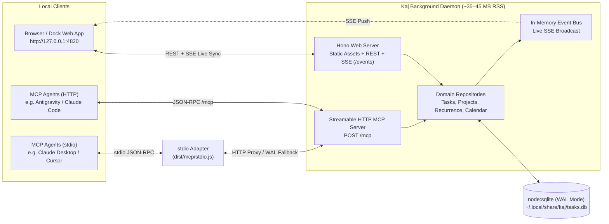

# Kaj (কাজ)

> **Kaj** (pronounced _/kadʒ/_, Bengali for **task** or **work** — **কাজ**) is a high-performance, low-footprint task management system and Model Context Protocol (MCP) daemon for macOS and local development environments.

Kaj combines a **6-column Kanban board with project swimlanes**, **dual-date scheduling** (Action Dates vs. Deadlines), an **interactive Month & Week calendar**, and a **first-class Model Context Protocol (MCP) server** that lets autonomous AI agents manage your tasks in real time over Streamable HTTP and stdio.

---

## Key Features

- **6-Column Kanban with Execution Horizons**:
  - `Triage`: Quick intake for unvetted items.
  - `Todo`: Backlog ready for prioritization.
  - `In Progress` grouped header with 3 execution sub-columns:
    - `Today`: Tasks actively worked on today.
    - `This Week`: Active weekly commitments.
    - `This Month`: Active monthly execution window.
  - `Tracking`: Dedicated parking column for blocked items, external dependencies, and package delivery tracking (with carrier numbers, status notes, and tracking links).
- **Project Swimlanes & Reordering**:
  - First-class Project entities with custom color tokens and collapsible swimlanes.
  - Interactive swimlane reordering controls to prioritize projects vertically.
  - Top-level `Unassigned / Quick Triage` swimlane for immediate friction-free task capture.
- **Dual-Date Scheduling**:
  - Independent **Action Date** (when you plan to work on the task) and **Due Date** (hard deadline).
  - Tasks can have an action date, a due date, both, or neither.
- **Interactive Calendar View (Month & Week)**:
  - Toggle between **Month view** (multi-week high-level grid) and **Week view** (focused 7-day schedule).
  - Distinct visual badges for Action Dates (`▶`) and Due Dates (`⚑`) with filter toggles.
  - **Unscheduled Tasks sidebar** for drag-to-schedule date assignment.
- **Spawn-on-Complete Recurrence**:
  - Repeating tasks (`weekly`, `monthly`, `yearly`) keep a single active card on the board.
  - Marking a recurring task `done` archives the finished occurrence and automatically spawns the next occurrence in `todo` with dates shifted forward (including leap year and end-of-month clamping, e.g. Jan 31 → Feb 28).
  - Future occurrences project virtual preview indicators onto the Calendar without database ghost rows.
- **Standard Model Context Protocol (MCP) Daemon**:
  - Dual-transport support: **Streamable HTTP** (`POST /mcp` on `127.0.0.1:4820`) and **stdio** CLI (`dist/mcp/stdio.js`).
  - Full CRUD and filtered queries for tasks and projects.
  - Real-time Server-Sent Events (SSE) push updates connected browser tabs in `< 20ms` when agents mutate tasks.
- **Ultra-Low Memory Footprint (~35–45 MB RSS)**:
  - Built on Node 26 using built-in `node:sqlite` in WAL mode (`PRAGMA journal_mode = WAL; PRAGMA busy_timeout = 5000;`).
  - Pre-compiled static single-page app (Preact + Vite + CSS design tokens) served directly by `Hono` — zero bundled Chromium or Electron bloat in the background daemon.
- **Bento × Chronos Dark-Mode UI**:
  - Full-width layout without left-sidebar clutter.
  - Chronos dark palette: Deep Graphite canvas (`#0E1111`), elevated pods (`#121718`), Emerald execution accents (`#10B981`), and warm Gold Tracking accents (`#EAB308`).
  - Accessible contrast ratios (>= 4.5:1 text, >= 3:1 component boundaries).

---

## Architecture Overview



---

## Getting Started

### Prerequisites

- **Node.js**: v26+ (recommended for built-in `node:sqlite`)
- **npm**: v11+
- **macOS** (or any modern Unix environment)

### Installation

Clone or navigate to the repository directory and install dependencies:

```bash
npm install
```

### Verification & Testing

Kaj strictly adheres to **Test-Driven Development (TDD)** and **Spec-Driven Development (SDD)**:

```bash
# Run unit & integration tests (< 5s)
npm run test:unit

# Run all test suites
npm test

# Verify 100% active criteria coverage and 0 hash drift via Spec Guardian
npm run audit:specs

# Run automated live UI verification (headless Chromium)
npm run test:ui
```

### Development & Build

```bash
# Start Vite development server
npm run dev

# Compile frontend assets and TypeScript server
npm run build

# Start production background server (binds to 127.0.0.1:4820)
npm start
```

---

## Connecting MCP Clients

Kaj exposes its MCP server over both **Streamable HTTP** (`http://127.0.0.1:4820/mcp`) and **stdio** (`dist/mcp/stdio.js`).

### 1. Streamable HTTP (Recommended for Running Daemon)

Add to your agent or client configuration (e.g. Claude Code, Antigravity, or custom agent):

```json
{
  "mcpServers": {
    "kaj": {
      "url": "http://127.0.0.1:4820/mcp"
    }
  }
}
```

### 2. Stdio Transport (For Desktop Tools)

Add to `claude_desktop_config.json` or Cursor MCP settings:

```json
{
  "mcpServers": {
    "kaj": {
      "command": "node",
      "args": ["<path-to-repo>/dist/mcp/stdio.js"]
    }
  }
}
```

### MCP Tools Catalog

| Tool                | Access        | Description                                                                                                            |
| :------------------ | :------------ | :--------------------------------------------------------------------------------------------------------------------- |
| `query_tasks`       | `readOnly`    | Query tasks with filters (`status[]`, `project_id`, `priority[]`, `action_date` range, `due_date` range, text search). |
| `get_task`          | `readOnly`    | Retrieve full details of a task by ID.                                                                                 |
| `get_board_summary` | `readOnly`    | Compact snapshot of task counts per column and swimlane + active Tracking items.                                       |
| `create_task`       | Write         | Create a task with title, status, project, priority, action/due dates, repeat rule, waiting note, and details.         |
| `update_task`       | Write         | Partially update any attribute of an existing task.                                                                    |
| `move_task`         | Write         | Move a task across columns or project swimlanes with optional waiting notes.                                           |
| `complete_task`     | Write         | Mark a task as completed (triggers spawn-on-complete rollover if repeating).                                           |
| `delete_task`       | `destructive` | Soft-delete a task (sets `deleted_at`).                                                                                |
| `restore_task`      | Write         | Recover a soft-deleted task.                                                                                           |
| `list_projects`     | `readOnly`    | List all projects with task counts and sort order.                                                                     |
| `save_project`      | Write         | Create or update a project (name, color, sort order, archive status).                                                  |

---

## Repository Structure

```text
.
├── .agents/
│   └── skills/
│       └── kaj-test-protocol/   # Mandatory local test protocol for release governance
├── specs/                       # Formal EARS specifications (fingerprinted by Spec Guardian)
│   ├── tasks.md                 # TASK-001..005: Workflow, validation, recurrence, calendar
│   ├── projects.md              # PROJ-001..002: Projects, swimlane reordering, unassigned lane
│   ├── mcp.md                   # MCP-001..003: Tools, dual transport, safety annotations
│   ├── ui.md                    # UI-001..004: Bento layout, Chronos palette, calendar, modals
│   └── traceability.json        # Auto-compiled Spec Guardian traceability manifest
├── src/
│   ├── shared/                  # Domain types and Zod validation schemas
│   │   └── types.ts
│   ├── server/                  # Backend daemon
│   │   ├── db.ts                # node:sqlite WAL initialization and migrations
│   │   ├── repository.ts        # Task & Project repositories, recurrence engine, calendar
│   │   └── index.ts             # Daemon entrypoint
│   └── client/                  # Preact + Vite frontend (Bento × Chronos UI)
├── tests/
│   ├── unit/                    # Fast deterministic unit tests (< 5s)
│   ├── integration/             # Database and HTTP integration tests
│   └── e2e/                     # Playwright live UI verification tests
├── AGENTS.md                    # Operating guidelines and Prime Directives for AI agents
├── release.md                   # 6-Gate Release pipeline and version roadmap
├── package.json                 # Project manifest and scripts
└── tsconfig.json                # TypeScript configuration
```

---

## Engineering Standards

- **Spec-First Rule**: No code or tests are written without an approved EARS requirement in `specs/`. Code is annotated with `// [spec: REQ-ID]` and tests with `// [verifies: REQ-ID/AC-ID]`.
- **Strict TDD**: All logic is developed through the `Red → Green → Refactor` cycle.
- **Mandatory Live UI Verification**: Any UI change must be verified against the live app via automated headless browser tests and visual DOM review before completion.
- **Zero Drift Auditing**: Spec Guardian (`npm run audit:specs`) guarantees 100% active criteria coverage and cryptographic block hash integrity.

---

## License

MIT
