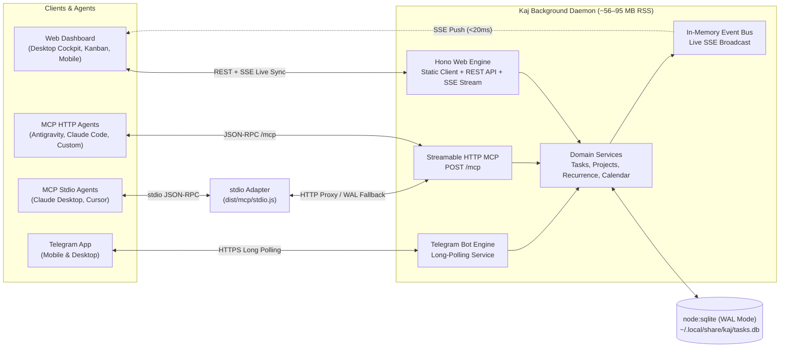

# Kaj (কাজ)

<div align="center">

[](release.md)
[](https://opensource.org/licenses/MIT)
[](https://nodejs.org/)
[](#low-memory-architecture)
[](specs/)

**A high-performance, low-footprint task management system and Model Context Protocol (MCP) server daemon.**

_Pronounced /kadʒ/, Bengali for task or work — **কাজ**._

</div>

---

## Overview

**Kaj** is a local-first task operating system engineered for individual builders, engineering teams, and autonomous AI agents. It combines a desktop **Execution Cockpit** with live telemetry, a **6-column Kanban board with collapsible project swimlanes**, **dual-date scheduling** (Action Dates vs. Deadlines), an **interactive Month & Week calendar**, a **thumb-friendly responsive mobile app**, a **deterministic Telegram bot companion**, and a **first-class Model Context Protocol (MCP) server** that lets autonomous AI agents manage your tasks in real time over Streamable HTTP and stdio.

Kaj runs as an always-on background daemon consuming only **~56–95 MB RSS**, utilizing Node 26 native `node:sqlite` in Write-Ahead Logging (WAL) mode without heavy bundled browsers or database server dependencies.

---

## Key Capabilities

### ⚡ Desktop Execution Cockpit (`v2.5.0`)

- **Split 2-Column Command Deck**:
  - **Today Focus Plate**: Accented chamber highlighting tasks actively committed for today, complete with 1-click completion and quick-add controls.
  - **Upcoming Horizons**: Visible queue for _This Week_ and _This Month_ commitments with 1-click promotion to Today.
  - **Tracking & Blockers**: Dedicated container for items waiting on external dependencies, colleagues, or delivery tracking numbers.
- **Real-Time Telemetry & Performance Engine**:
  - **Weekly Velocity Chart**: Visual bar chart tracking completed task throughput across the last 6 ISO weeks.
  - **Project Distribution Donut**: Live radial breakdown illustrating workload distribution across project swimlanes.
  - **Creator-Segmented Stacked Velocity Graph**: Horizontal stacked graph attributing completed work to its creator (`created_by`) across weekly intervals.
- **Top Command Bar Switcher**: Instant navigation between **Cockpit**, **Kanban Board**, and **Calendar**.

### 📋 Bento Kanban Board & Project Swimlanes

- **6-Column Structured Workflow**:
  - `Triage` → `Todo` → `In Progress` (`Today`, `This Week`, `This Month`) → `Tracking`.
- **Project Swimlane Pods**:
  - First-class Project entities with custom color tokens and collapsible pod headers.
  - Vertical swimlane reordering (`↑` / `↓`) and top-level `Unassigned / Quick Triage` inbox for zero-friction capture.
- **Intra-Column Drag-and-Drop Reordering**: Persists card order with instant visual drop target indicators.
- **Card Density Modes**:
  - **Compact Mode** (Default, ~65px): Streamlined layout with priority chips, single-line titles, inline dates, and blocker badges.
  - **Minimal Mode** (~36px, >75% height reduction): Ultra-dense single-line row designed to keep massive backlogs visible on a single display without vertical scrolling.

### 📱 Responsive Mobile App (< 768px)

- **Sticky 4-Tab Navigation Dock**: ⚡ Cockpit, 📋 Pods, 📅 7-Day, and 📥 Triage.
- **Touch Swipe-to-Complete**: Swipe cards right with emerald feedback to complete tasks on touch devices.
- **One-Thumb Action Sheet**: Bottom modal sheet replacing desktop drag-and-drop on mobile viewports for rapid column switching, project pod reassignment, and archiving.

### 📅 Dual-Date Scheduling & Interactive Calendar

- **Decoupled Scheduling**:
  - **Action Date (`▶`)**: When you plan to execute or work on the task.
  - **Due Date (`⚑`)**: Hard commitment deadline.
  - Tasks can have an action date, a due date, both, or neither.
- **Month & Week Grid Views**: Real-time projection with distinct visual date badges and type filters.
- **Unscheduled Sidebar**: Slide-out tray for 1-click scheduling or dragging unscheduled tasks directly onto target dates.

### 🔄 Spawn-on-Complete Recurrence Rollover

- Supports `weekly`, `monthly`, and `yearly` recurrence rules with explicit day-of-week, day-of-month, and day-of-year anchors.
- Marking a recurring task done automatically archives the finished instance and spawns the next occurrence directly into `triage` with dates shifted forward and an execution period tag appended (e.g. `[W45]`, `[11]`, `[2027]`).
- Future occurrences project virtual previews onto the Calendar without database ghost rows.

### 🤖 Model Context Protocol (MCP) Server

- Dual-transport architecture: **Streamable HTTP** (`POST /mcp` on `127.0.0.1:4820`) and **stdio** CLI (`dist/mcp/stdio.js`).
- Complete 11-tool suite declared with precise `Zod` schemas and tool annotations (`readOnlyHint`, `destructiveHint`).
- Real-time Server-Sent Events (SSE) push updates to connected web clients in `< 20ms` when agents mutate state.

### ✈️ Deterministic Telegram Bot Companion

- Built-in long-polling Telegram bot service running inside the daemon with **~0 MB extra memory overhead** and **zero local LLM requirements**.
- **Deterministic Shorthand Syntax**:
  - `/add Implement OAuth #Auth !today @tomorrow due:2026-11-15 wait:DevOps`
  - Quick commands: `/today`, `/search <query>`, `/add <text>`, `/help`.
  - Inline buttons for instant 1-tap `✓ Done` completion and status changes.
  - Automatic creator attribution (`created_by`) mapped to friendly user names via `KAJ_TELEGRAM_USER_NAMES` in `.env`.

---

## Architecture



---

## Getting Started

### Prerequisites

- **Node.js**: v26+ (required for built-in `node:sqlite`)
- **npm**: v11+
- **macOS** or **Linux**

### Installation

```bash
# Clone the repository
git clone https://github.com/your-username/kaj.git
cd kaj

# Install dependencies
npm install

# Build client bundle and server
npm run build
```

### Running the App

```bash
# Foreground execution (binds to 0.0.0.0:4820)
npm start

# Development mode with hot-reloading
npm run dev
```

Visit **`http://localhost:4820`** in your browser.

---

## Background Daemon & Auto-Start on Boot

Kaj includes a daemon management script (`scripts/daemon-ctl.sh`) that integrates with macOS `launchd` LaunchAgents, allowing Kaj to run quietly in the background and auto-start on system boot:

| Action                   | NPM Script                 | CLI Command                         | Description                                                                 |
| :----------------------- | :------------------------- | :---------------------------------- | :-------------------------------------------------------------------------- |
| **Start Daemon**         | `npm run daemon:start`     | `./scripts/daemon-ctl.sh start`     | Starts Kaj in background (~56–95 MB RSS)                                    |
| **Stop Daemon**          | `npm run daemon:stop`      | `./scripts/daemon-ctl.sh stop`      | Gracefully stops the background daemon                                      |
| **Restart Daemon**       | `npm run daemon:restart`   | `./scripts/daemon-ctl.sh restart`   | Restarts daemon and reloads compiled code                                   |
| **Check Status**         | `npm run daemon:status`    | `./scripts/daemon-ctl.sh status`    | Displays PID, memory usage, and health                                      |
| **View Logs**            | `npm run daemon:logs`      | `./scripts/daemon-ctl.sh logs`      | Tails live log output (`~/.local/share/kaj/daemon.log`)                     |
| **Install Auto-Start**   | `npm run daemon:install`   | `./scripts/daemon-ctl.sh install`   | Registers macOS LaunchAgent (`~/Library/LaunchAgents/com.kaj.daemon.plist`) |
| **Uninstall Auto-Start** | `npm run daemon:uninstall` | `./scripts/daemon-ctl.sh uninstall` | Unregisters and deletes the LaunchAgent                                     |

```bash
# Setup auto-start on macOS login (one-time setup)
npm run build
npm run daemon:install
```

---

## Telegram Bot Setup (Optional)

1. Ensure `.env` exists in the repository root (`cp .env.example .env`).
2. Message `@BotFather` on Telegram to create a bot and get an API token.
3. Add or uncomment the `KAJ_TELEGRAM_*` variables in `.env`:
   ```env
   KAJ_TELEGRAM_ENABLED=true
   KAJ_TELEGRAM_BOT_TOKEN="YOUR_TELEGRAM_BOT_TOKEN"
   KAJ_TELEGRAM_ALLOWED_USER_IDS="123456789"
   KAJ_TELEGRAM_USER_NAMES='{"123456789":"Alex [VIP]"}'
   KAJ_TELEGRAM_DEFAULT_STATUS="triage"
   KAJ_TELEGRAM_POLL_INTERVAL_MS=2000
   KAJ_TELEGRAM_DAILY_DIGEST_ENABLED=true
   KAJ_TELEGRAM_DAILY_DIGEST_TIME="08:00"
   KAJ_TELEGRAM_DAILY_DIGEST_MAX_ITEMS=15
   KAJ_TELEGRAM_DAILY_DIGEST_SKIP_EMPTY=true
   ```
4. Control the bot via CLI:
   ```bash
   npm run telegram:on      # Enable bot
   npm run telegram:off     # Disable bot
   npm run telegram:status  # Check bot status
   ```

   **Daily Non-VIP Task Digest (`NOTIF-002`)**: When `KAJ_TELEGRAM_DAILY_DIGEST_ENABLED=true`, Kaj sends each non-VIP allowed user a brief numbered Telegram list once per calendar day at `KAJ_TELEGRAM_DAILY_DIGEST_TIME` (default `"08:00"` local time, with sleep-safe catch-up persisted in SQLite). Tasks are drawn from active `in_progress_today` (In Progress Today) items, ordered with `action_date === today` at top (capped via `KAJ_TELEGRAM_DAILY_DIGEST_MAX_ITEMS=15`), and skipped on empty days when `KAJ_TELEGRAM_DAILY_DIGEST_SKIP_EMPTY=true`. Trigger manually via `POST /api/telegram/daily-digest`.

---

## Encrypted Daily Backup & Disaster Recovery

Kaj provides built-in, zero-dependency encrypted daily backups and atomic disaster recovery backed by Node 26 `node:crypto` (**AES-256-GCM** + `scrypt` key derivation) and SQLite hot snapshots (`VACUUM INTO`).

### 1. Environment Configuration (`.env`)

Create `.env` in the repository root from the provided template:

```bash
cp .env.example .env
```

Configure these core variables in `.env`:

```bash
# Active SQLite database file location (shared by Daemon, Backup, MCP Stdio & Recovery CLI)
# Keep on local disk to prevent cloud sync WAL locking conflicts.
KAJ_DB_PATH="~/.local/share/kaj/tasks.db"

# Target folder inside Google Drive (or other cloud sync folder)
KAJ_BACKUP_DIR="~/Library/CloudStorage/GoogleDrive-you@gmail.com/My Drive/KajBackups"

# Encryption passphrase for daily backups (alternatively store passphrase in ~/.config/kaj/backup.key)
KAJ_BACKUP_KEY="your-secret-passphrase-here"
```

### Completed Task Auto-Purge & Telemetry Snapshots (`TASK-010` / `UI-013`)

Kaj keeps active queries fast by auto-purging `done` tasks older than **90 days** (`KAJ_DONE_RETENTION_DAYS=90`, set `0` to disable) while atomically saving weekly, project, and creator aggregates in `completed_telemetry_snapshots` so Desktop Cockpit charts preserve full historical counts. Use the **Purge > 90d** button in the Completed Archive drawer (`POST /api/completed/purge`) to run the sweep manually at any time.

### 2. How Daily Automated Backups Work (`BACKUP-001`)

- **Sleep-Safe Catch-Up Schedule**: On daemon startup and once every hour, Kaj checks if today's backup (`kaj-backup-DD-MM-YYYY.db.enc`) already exists inside `KAJ_BACKUP_DIR`.
- **Non-Locking Hot Snapshot**: Uses `VACUUM INTO` to consolidate active WAL transactions into a single temporary snapshot without locking live operations, encrypts it via AES-256-GCM, and removes the temporary unencrypted file immediately.
- **7-Day Rolling Retention**: Deletes only `kaj-backup-*.db.enc` files older than 7 calendar days inside `KAJ_BACKUP_DIR`, leaving all other files untouched.
- **Strict Directory Isolation**: Kaj **never** scans, lists, or traverses parent or sibling folders outside `KAJ_BACKUP_DIR`.
- **Brief Telegram Alerts**: When Telegram is enabled, Kaj sends a brief pathless confirmation (`✅ Kaj Backup Successful: kaj-backup-DD-MM-YYYY.db.enc`) or failure alert (`⚠️ Kaj Backup Failed: Backup directory not accessible or not found. Please check Google Drive.`) exclusively to non-VIP members.

### 3. Restoring Your Database (`BACKUP-002`)

Always build (`npm run build`) before running recovery commands for the first time:

```bash
# Interactive recovery: lists backups strictly inside KAJ_BACKUP_DIR and restores to KAJ_DB_PATH
npm run recover

# Restore from an explicit backup archive (e.g., on a new machine or USB drive)
npm run recover -- --file "/path/to/kaj-backup-13-11-2026.db.enc"

# Verify decryption, SQLite integrity, and task/project counts WITHOUT modifying the live DB
npm run recover -- --file "/path/to/kaj-backup-13-11-2026.db.enc" --verify-only

# Restore to a custom target database path non-interactively
npm run recover -- --file "/path/to/backup.db.enc" --target "/custom/path/tasks.db" --yes
```

**What `npm run recover` Guarantees:**
1. **Staged Validation First**: Decrypts into a temporary staging file, validates AES-256-GCM authentication, runs `PRAGMA integrity_check`, and verifies core Kaj tables before touching your live database.
2. **Schema Versioning & Compatibility Guard**: Inspects SQLite `PRAGMA user_version` cleanly. Older backups run sequential transactional forward migrations in staging automatically; incompatible newer backups abort safely without modifying your live DB.
3. **Daemon Shutdown & Pre-Restore Snapshot**: Gracefully stops the running daemon, creates a consolidated local rollback snapshot (`<KAJ_DB_PATH>.pre-restore-DD-MM-YYYY-HHmmss.bak`) via `VACUUM INTO`, removes stale `-wal` and `-shm` sidecar files, atomically swaps the verified database into `KAJ_DB_PATH`, and restarts the daemon.

### 4. Standalone Offline Decryption

To inspect or extract a backup as a raw SQLite `.db` file without running the Kaj app (for instance, on another machine with Node.js installed):

```bash
node scripts/decrypt-backup.js /path/to/kaj-backup-13-11-2026.db.enc ./restored-tasks.db
```

> [!IMPORTANT]
> For full disaster recovery after a laptop loss, keep your passphrase (`KAJ_BACKUP_KEY` or `~/.config/kaj/backup.key`) backed up securely in a password manager separately from Google Drive.

---

## Connecting Model Context Protocol (MCP) Clients

Kaj supports both **Streamable HTTP** and **stdio** MCP connections.

### 1. Streamable HTTP (Recommended for Background Daemon)

Add Kaj to your agent configuration (e.g., Claude Code, Google Antigravity):

```json
{
  "mcpServers": {
    "kaj": {
      "url": "http://127.0.0.1:4820/mcp"
    }
  }
}
```

### 2. Stdio Transport (For Desktop Tools)

Add Kaj to `claude_desktop_config.json` or Cursor settings:

```json
{
  "mcpServers": {
    "kaj": {
      "command": "node",
      "args": ["/absolute/path/to/kaj/dist/mcp/stdio.js"]
    }
  }
}
```

### MCP Tools Catalog

| Tool                | Access        | Description                                                                                                |
| :------------------ | :------------ | :--------------------------------------------------------------------------------------------------------- |
| `query_tasks`       | `readOnly`    | Query tasks with filters (`status[]`, `project_id`, `priority[]`, `action_date`, `due_date`, text search). |
| `get_task`          | `readOnly`    | Retrieve full details of an individual task by ID.                                                         |
| `get_board_summary` | `readOnly`    | Compact snapshot of task counts per column, swimlane distribution, and active tracking blockers.           |
| `create_task`       | Write         | Create a task with title, status, project, priority, dates, recurrence, waiting note, and details.         |
| `update_task`       | Write         | Partially update attributes of an existing task.                                                           |
| `move_task`         | Write         | Move a task across columns or project swimlanes.                                                           |
| `complete_task`     | Write         | Mark a task as completed (triggers spawn-on-complete rollover if recurring).                               |
| `delete_task`       | `destructive` | Soft-delete a task (`deleted_at` timestamp).                                                               |
| `restore_task`      | Write         | Recover a soft-deleted task.                                                                               |
| `list_projects`     | `readOnly`    | List all projects with active task counts and sort orders.                                                 |
| `save_project`      | Write         | Create or update a project entity (name, color, sort order, archive status).                               |

---

## Verification & Testing

Kaj enforces strict **Test-Driven Development (TDD)** and **Spec-Driven Development (SDD)**:

```bash
# Run unit tests (< 1s)
npm run test:unit

# Run full Vitest test suite (unit + integration)
npm test

# Run Playwright live browser UI verification
npm run test:ui

# Verify 100% active requirement coverage and zero hash drift via Spec Guardian
npm run audit:specs
```

---

## Repository Structure

```text
.
├── specs/                          # Formal EARS requirements (cryptographically fingerprinted)
│   ├── tasks.md                    # TASK-001..006: Workflow, validation, recurrence, ordering
│   ├── projects.md                 # PROJ-001..002: Project entities, swimlanes, inbox
│   ├── mcp.md                      # MCP-001..003: Tools, transports, safety annotations
│   ├── telegram.md                 # TG-001: Telegram bot integration & token parsing
│   ├── notifications.md            # NOTIF-001: Automated task & VIP triage notifications
│   ├── backup.md                   # BACKUP-001..002: Encrypted backups & verified CLI recovery
│   ├── ui.md                       # UI-001..009: Bento, Chronos, Calendar, Mobile, Cockpit
│   └── traceability.json           # Automated Spec Guardian verification manifest
├── src/
│   ├── shared/                     # Domain schemas and TypeScript types
│   │   └── types.ts
│   ├── server/                     # Backend daemon
│   │   ├── db.ts                   # node:sqlite WAL initialization, KAJ_DB_PATH, & migrations
│   │   ├── recurrence.ts           # Pure recurrence calculation and period tagging engine
│   │   ├── retention.ts            # Done-task retention auto-purge and telemetry snapshots
│   │   ├── repository.ts           # Task and Project SQLite repositories
│   │   ├── events.ts               # In-memory SSE event bus
│   │   ├── app.ts                  # Hono REST endpoints and route handlers
│   │   ├── backup/                 # Encrypted backup & recovery engine
│   │   │   ├── crypto.ts           # Built-in node:crypto AES-256-GCM + scrypt encryption
│   │   │   ├── service.ts          # Daily backup runner, 7-day pruning, pathless alerts
│   │   │   ├── recover.ts          # Staged decryption, integrity/schema checks, atomic swap
│   │   │   └── recover-cli.ts      # CLI recovery command (npm run recover)
│   │   ├── telegram/               # Telegram parser, transport, config, formatters, and daily digest
│   │   │   ├── config.ts
│   │   │   ├── digest.ts
│   │   │   ├── formatters.ts
│   │   │   ├── parser.ts
│   │   │   ├── transport.ts
│   │   │   └── types.ts
│   │   └── index.ts                # Server entrypoint
│   ├── client/                     # Preact + Tailwind CSS frontend
│   │   ├── components/
│   │   │   ├── cockpit/            # Desktop Cockpit execution and telemetry subcomponents
│   │   │   ├── mobile/             # Responsive mobile tabs, cards, and action sheets
│   │   │   ├── task-modal/         # Task modal emoji palette, markdown toolbar, recurrence
│   │   │   ├── CalendarView.tsx    # Interactive Month & Week calendar
│   │   │   ├── SwimlaneBoard.tsx   # Bento 6-column Kanban board
│   │   │   ├── DesktopCockpit.tsx  # Desktop Cockpit container
│   │   │   └── TopBar.tsx          # Top navigation bar and density switcher
│   │   └── App.tsx                 # Client application state orchestrator
│   └── mcp/                        # Model Context Protocol implementation
│       ├── server.ts               # Streamable HTTP MCP server handler
│       └── stdio.ts                # Stdio CLI adapter
├── tests/
│   ├── unit/                       # Deterministic unit tests (tasks, calendar, recurrence, backup, recover)
│   ├── integration/                # SQLite integration and MCP protocol tests
│   └── e2e/                        # Playwright automated browser verification
├── tools/
│   └── guardian.py                 # Self-contained zero-dependency EARS specification auditor
├── scripts/
│   ├── daemon-ctl.sh               # Background daemon manager & LaunchAgent installer
│   └── decrypt-backup.js           # Standalone zero-dependency backup decryption utility
├── .env.example                    # Environment configuration template (KAJ_DB_PATH, KAJ_BACKUP_DIR)
├── ADR.md                          # Architecture Decision Records
├── AGENTS.md                       # Operating guidelines and verification protocols for AI agents
├── release.md                      # 6-Gate release roadmap and version history
├── package.json                    # Project metadata and dependencies
└── tsconfig.json                   # TypeScript configuration
```

---

## Contributing & Engineering Standards

- **Spec-First Rule**: Every new feature or behavioral change begins with an approved EARS requirement in `specs/`. Code must include `// [spec: REQ-ID]` and tests must include `// [verifies: REQ-ID/AC-ID]`.
- **Strict TDD**: Follow the Red → Green → Refactor development cycle.
- **Spec Guardian Strict Audit**: Run `npm run audit:specs` to ensure 100% active criteria coverage and zero requirement hash drift before committing.
- **Low Memory Architecture**: The daemon must remain low-footprint (~56–95 MB RSS under traffic).

---

## License

This project is open-source software licensed under the [MIT License](LICENSE).
